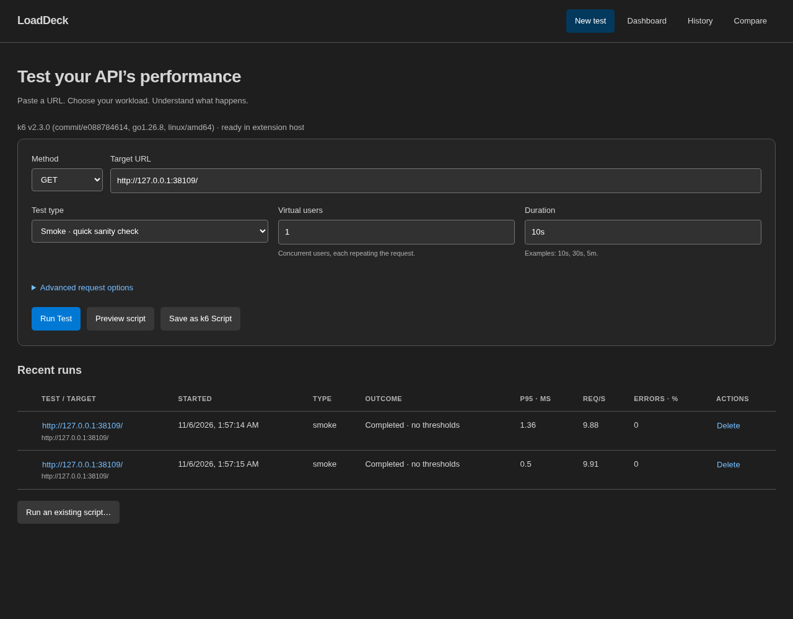
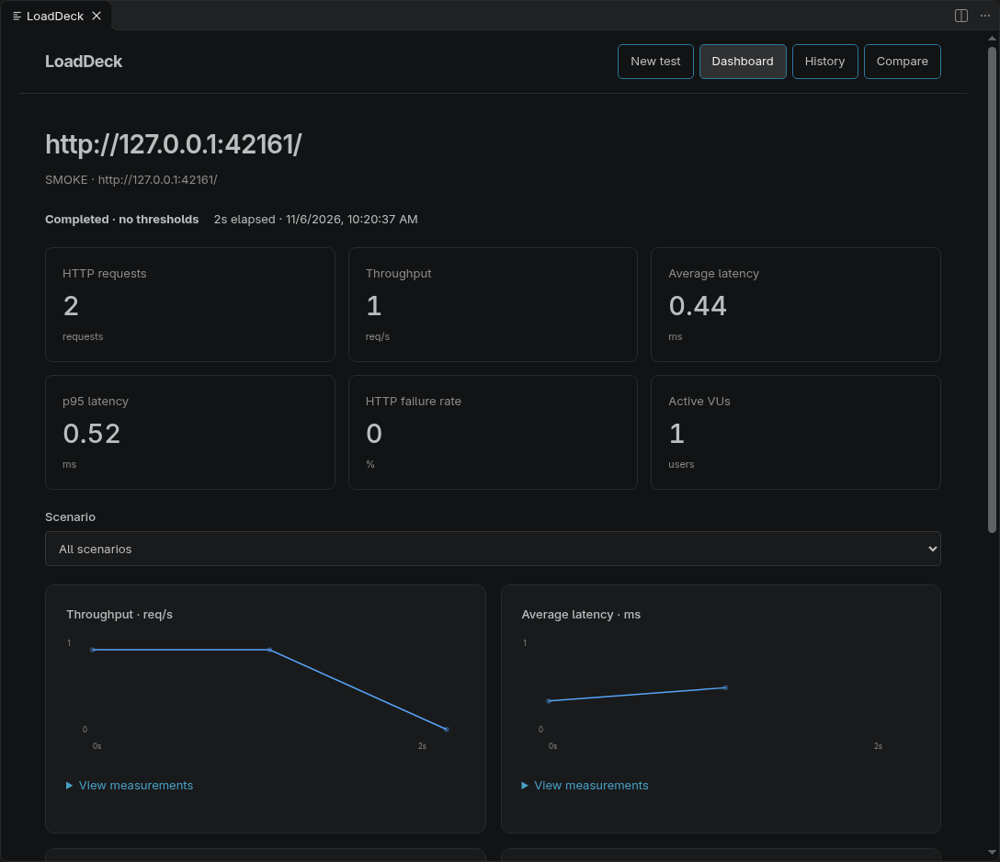
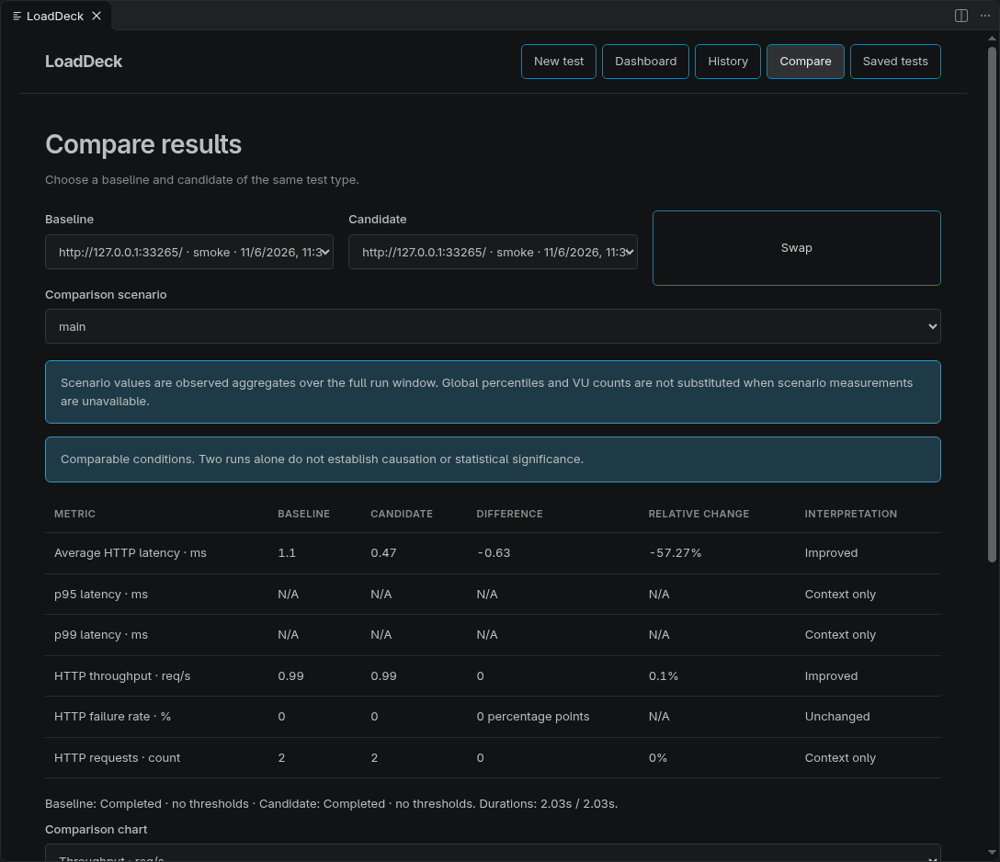

# LoadDeck

Performance testing inside VS Code, powered by the actual Grafana k6 engine. Paste a URL, run a conservative smoke test, and inspect live measurements, saved results and comparisons.

LoadDeck is an independent project, with no Grafana Labs affiliation. This is a **0.1 development preview**, not a stable 1.0 release. See [readiness and verification](docs/READINESS.md) for the remaining release gates.



## Try it locally

1. Install [Grafana k6](https://grafana.com/docs/k6/latest/set-up/install-k6/) in the environment running the VS Code extension host. Remote SSH, WSL and containers need their own binary. Local integration verification currently uses k6 v2.3.0.
2. Run `npm ci` and `npm run build` in this repository.
3. Open the repository in desktop VS Code and press F5 using **Run LoadDeck**.
4. Open LoadDeck from the Activity Bar. Enter a target you own or are authorized to test, then select **Run Test**.

No project folder or saved script is required for a quick test. Smoke defaults to one virtual user for ten seconds. Load defaults to ten users for thirty seconds. Advanced scenarios override the preset workload and display their actual settings. Stress ramps to twice the configured users; Spike ramps abruptly and recovers; Soak suggests thirty minutes of sustained traffic. Larger or longer tests require acknowledgment.

Use `loaddeck.binaryPath` if k6 is outside the extension host's PATH. **LoadDeck: Check Installation** retries discovery. Never disable certificate verification to work around a missing local trust root; configure the extension host's certificate trust instead.

## Workflows

- **New test:** GET, POST, PUT, PATCH, DELETE, HEAD and OPTIONS; headers, JSON, text, form-encoded or multipart bodies, expected status, think time and thresholds.
- **Dashboard:** live observed counts, average latency, throughput, failures, VUs, scenario filters, logs and Stop. Final percentiles come from k6's summary for generated tests. Missing measurements display N/A.
- **History:** compact local results, filters, dates, reopening, rerun where safely reproducible, deletion and retention. The default is fifty runs.
- **Compare:** choose exactly two same-type runs and optionally a common scenario. Charts share identical elapsed-time and value scales. Differences in target, workload or acceptance criteria suppress verdicts, as do incomplete/aborted observations. Missing scoped percentiles remain N/A; zero baselines have no relative percentage. Native WebSocket/gRPC measurements are compared with their own units.
- **Advanced builder:** independently scheduled scenarios with their own requests, protocols, authentication, datasets and checks, all six executors, checks, scoped thresholds, HTTP/2 negotiation, WebSocket and unary gRPC, protected authentication references, JSON/CSV datasets and native outputs.
- **Saved tests:** save reusable protected configurations, edit/run them from Saved tests, and rerun their results without putting raw requests in History. Names remain visible; configurations use VS Code SecretStorage.
- **Scripts:** preview or save standalone JavaScript with copied relative dataset/upload/schema dependencies; run existing scripts through the palette or Explorer. Existing source and its original options are preserved. Custom scripts do not provide authoritative final percentiles unless a compatible summary adapter is available; observed metrics remain usable.
- **Exports:** normalized result JSON, CSV and standalone HTML reports differ from granular native k6 JSON/CSV output files.



Home screenshots use the actual bundled webview in its browser test harness. The results screenshot comes from the desktop VS Code webview and contains measurements from a real loopback k6 run.



## Checks and thresholds

Advanced checks support allowed HTTP status lists, response text/regex, JSON paths, case-insensitive headers, UTF-16 string length and UTF-8 encoded text size. Group names, nonsecret tags and scenario filters organize their results. UTF-8 size measures decoded response text, not compressed network-transfer bytes. A WebSocket content check fails when no message arrives before the configured session closes; an actual empty message can still match an empty-string pattern.

Threshold controls offer only valid aggregations for each metric type. Rate values are ratios (`0.01` means 1%); timing values use milliseconds. Decimal percentiles are supported. Observed metric definitions are retained in History and can inform custom rules. Selecting a custom metric name does not create measurements: the script must actually emit that metric.

JSON-form thresholds and visual rules are combined. Use **Abort on failure** and its evaluation delay to stop early. Aborted observations stay visibly incomplete in History and Compare. A missing evaluation is shown as **Not evaluated**; a normal run without thresholds is never presented as having passed an SLA. Checks alone do not change k6's exit status—add a `checks` threshold to enforce them.

## Credentials and data

Use `${API_TOKEN}` in sensitive headers or URL query values. Authentication fields take variable names, never credential values. **Store secret securely** saves values in VS Code SecretStorage. Alternatively, provide variables in the extension host environment. Saved scripts require those variables when run independently. Existing scripts can opt into named protected variables through `loaddeck.scriptEnvironment`; use **LoadDeck: Store Runtime Credential** to set their values. Generated tests on the verified k6 2.3.x profile prefer a private temporary k6 file secret source for eligible single-line values. PEM/multiline values, saved scripts and other profiles use environment injection, which lacks the same automatic redaction guarantees. Use **LoadDeck: Manage Runtime Credentials** to update or remove stored values.

Datasets use a local JSON array of objects or CSV with unique headers. Use `{{column}}` placeholders in request values. JSON bodies can use a quoted `"{{column}}"` to preserve the dataset value's type. File-backed data uses `SharedArray`. Round-robin and unique mappings are scoped to scenario iterations; there is no globally unique row guarantee across scenarios. The selected exhaustion policy either wraps or fails.

Bodies, credentials, full dataset rows, URL queries and raw metric files are not stored in history. For reproducible sensitive requests, explicitly save a protected test and start it from Saved tests. Its History entry retains only the template ID; deleting the template requires re-entering the settings. Known secrets and credential-bearing URLs are redacted from logs on a best-effort basis; arbitrary custom scripts can print sensitive values the extension cannot identify. Review logs and raw outputs before sharing them.

Generated runs isolate ambient k6 configuration and K6_* options so they cannot silently override the displayed workload or enable external outputs. Existing scripts preserve the user's k6 environment. No account, backend or telemetry is required by LoadDeck. External destinations are explicitly enabled per test and currently limited to the tested k6 v2.3.x InfluxDB v1-compatible and Prometheus remote-write adapters. They require an existing service and acknowledgment that metrics leave the machine.

## Development

```sh
npm ci
npm run check
npm run format:check
LOADDECK_TEST_K6=/absolute/path/to/k6 npm test
LOADDECK_TEST_K6=/absolute/path/to/k6 LOADDECK_TEST_BROWSER=/absolute/path/to/chromium npm test
LOADDECK_TEST_VSCODE=/absolute/path/to/code LOADDECK_TEST_K6=/absolute/path/to/k6 npm run test:vscode:ui
npm run package
```

Integration fixtures listen only on loopback. Browser verification uses installed Chromium through Playwright, without downloading another browser. Optional integration suites report explicit skips when their environment variables are absent. The TLS fixture additionally needs OpenSSL and is skipped on Windows. Rebuild before browser tests because they exercise the bundled webview.

Packaging creates a local VSIX; it does not publish anything. Publisher and license remain maintainer decisions. No publisher or license identity is invented in this preview.

See [CONTRIBUTING.md](CONTRIBUTING.md), [architecture](docs/ARCHITECTURE.md), [verification](docs/READINESS.md), and the [authoritative requirements](README.md).
